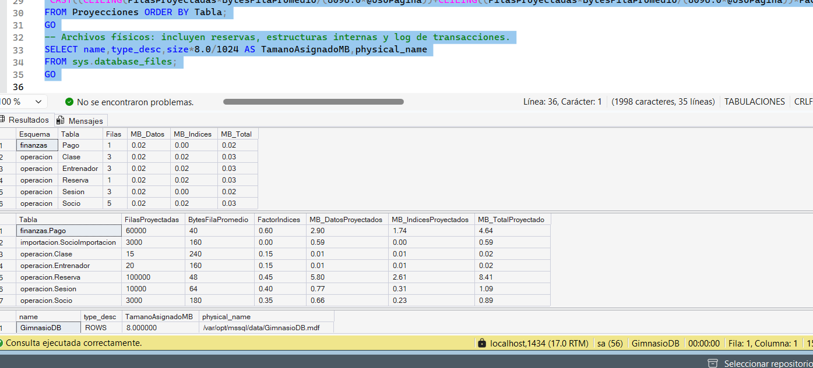

# Dimensionamiento de GimnasioDB

## Espacio usado en la instancia de prueba

La consulta contó 16 filas entre seis tablas. El tamaño de datos incluye el índice agrupado cuando existe. La columna de índices mide los índices adicionales. Las cifras están en MB y se redondean después de contar las páginas de cada objeto.

| Tabla | Filas | Datos (MB) | Índices (MB) | Total (MB) |
|---|---:|---:|---:|---:|
| `finanzas.Pago` | 1 | 0.02 | 0.00 | 0.02 |
| `operacion.Clase` | 3 | 0.02 | 0.02 | 0.03 |
| `operacion.Entrenador` | 3 | 0.02 | 0.02 | 0.03 |
| `operacion.Reserva` | 1 | 0.02 | 0.02 | 0.03 |
| `operacion.Sesion` | 3 | 0.02 | 0.00 | 0.02 |
| `operacion.Socio` | 5 | 0.02 | 0.02 | 0.03 |

Los totales mostrados por tabla suman aproximadamente 0.16 MB. SQL Server tiene asignados 8.00 MB al archivo de datos GimnasioDB.mdf. La captura solo permite leer la fila del archivo de datos.

## Proyección por tabla

El escenario supone 3,000 socios, 10,000 sesiones y 100,000 reservas, equivalentes a diez reservas por sesión en promedio. Las cantidades son supuestos de volumen del proyecto. Para estimar páginas, el script multiplica las filas por el tamaño medio de fila y divide entre 8,096 bytes útiles por página con una ocupación del 80 %. Calcula las páginas de índices aplicando el factor de cada tabla a las páginas de datos antes del redondeo. Redondea ambos conteos de páginas hacia arriba y convierte cada página a 8 KB.

| Tabla | Filas previstas | Bytes por fila | Factor de índices | Datos (MB) | Índices (MB) | Total (MB) |
|---|---:|---:|---:|---:|---:|---:|
| `finanzas.Pago` | 60,000 | 40 | 60 % | 2.90 | 1.74 | 4.64 |
| `importacion.SocioImportacion` | 3,000 | 160 | 0 % | 0.59 | 0.00 | 0.59 |
| `operacion.Clase` | 15 | 240 | 15 % | 0.01 | 0.01 | 0.02 |
| `operacion.Entrenador` | 20 | 160 | 15 % | 0.01 | 0.01 | 0.02 |
| `operacion.Reserva` | 100,000 | 48 | 45 % | 5.80 | 2.61 | 8.41 |
| `operacion.Sesion` | 10,000 | 64 | 40 % | 0.77 | 0.31 | 1.09 |
| `operacion.Socio` | 3,000 | 180 | 35 % | 0.66 | 0.23 | 0.89 |

El escenario completo ocupa aproximadamente **15.64 MB**, calculados antes de redondear por tabla. Reserva y Pago concentran cerca del 83 % del total. La proyección incluye la tabla auxiliar de importación. La medición actual muestra únicamente las seis tablas de negocio. El alcance de la proyección comprende datos e índices; el log de transacciones y los respaldos requieren espacio aparte.

[Consulta de dimensionamiento](../sql/09_Dimensionamiento.sql)

