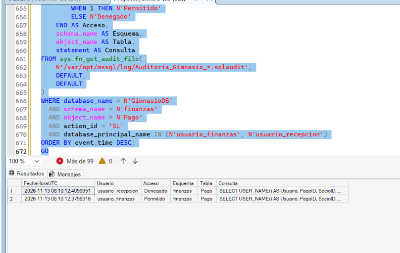
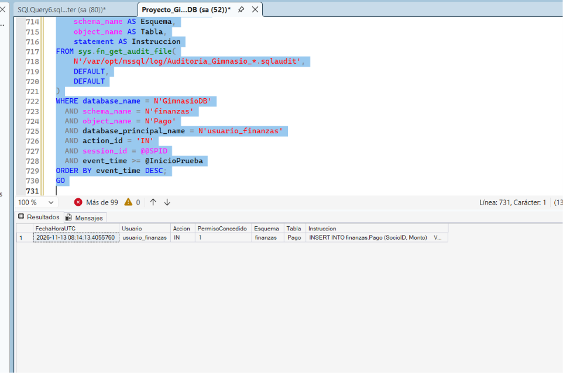

# Seguridad y auditoría de GimnasioDB

## Organización y permisos

La base separa las actividades del gimnasio en dos esquemas. `operacion` agrupa socios, entrenadores, clases, sesiones y reservas. `finanzas` contiene los pagos. Esta separación facilita identificar qué objetos necesita cada área y mantener sus permisos según la función del personal.

| Rol | Usuario de prueba | Permisos asignados |
|---|---|---|
| `rol_recepcion` | `usuario_recepcion` | Consulta y registra socios. Consulta clases, sesiones y reservas, y puede leer el identificador, nombres y apellidos de los entrenadores. Registra y cancela reservas mediante los procedimientos `operacion.RegistrarReserva` y `operacion.CancelarReserva`. |
| `rol_finanzas` | `usuario_finanzas` | Consulta y registra pagos en `finanzas.Pago`. De los socios puede consultar únicamente `SocioID`, `Nombres` y `Apellidos` para identificar a quien realiza el pago. |

Se aplicó el principio de mínimo privilegio. Por ejemplo, recepción registra una reserva mediante un procedimiento que valida el cupo y comprueba que el socio esté activo. Para comprobar los permisos de ambos roles se crearon usuarios de prueba con `WITHOUT LOGIN` y se ejecutaron consultas bajo la identidad de cada uno mediante `EXECUTE AS USER`.

## Auditoría de pagos

La auditoría del servidor `Auditoria_Gimnasio` escribe los eventos en `/var/opt/mssql/log/`. En `GimnasioDB`, la especificación `Auditoria_Pagos` registra las acciones `SELECT` e `INSERT` sobre `finanzas.Pago` para todos los usuarios de la base. Los eventos se consultaron con `sys.fn_get_audit_file`.

### Prueba 1. Consulta de pagos

Se ejecutó la misma consulta sobre `finanzas.Pago` con ambos usuarios. El registro muestra que SQL Server permitió el acceso a `usuario_finanzas` y se lo denegó a `usuario_recepcion`. Cada fila identifica al usuario, la hora UTC, el objeto consultado y el resultado de la comprobación del permiso.

### Prueba 2. Registro de un pago

`usuario_finanzas` ejecutó un `INSERT` de prueba por $1.00. El registro muestra la acción `IN` sobre `finanzas.Pago` con `PermisoConcedido = 1`. La transacción se revirtió con `ROLLBACK`, por lo que el intento autorizado quedó documentado y el pago de prueba no se incorporó al saldo de pagos registrados.

